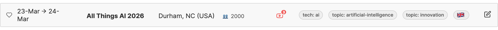
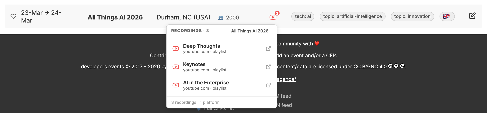

# How recordings are processed

Conference recordings are stored in `METADATA.csv` and flow through
`tools/mdParser.js` into `page/src/misc/all-events.json`, which the website
renders. For research methods, known discovery misses, and verification rules,
see [recordings-discovery.md](recordings-discovery.md).

## Format

```csv
2026-04-22-Devoxx France 2026,attendees:4600,recordings:[Keynotes](https://www.youtube.com/playlist?list=PLTbQvx84FrARmATtGZ-lPoT0fPV49seWw) | [Deep Dive](https://www.youtube.com/playlist?list=PLTbQvx84FrASQQ2rugdm8IMq1ceA0mWGv)
```

- The `recordings:` field holds one or more entries separated by ` | `.
- Each entry is a bare URL or `[label](url)`. Label every entry when there are several.
- `recording:` (singular) is accepted on read for a hand-typed single link;
  both keys merge in line order.
- Entries must be `http(s)` URLs; anything else is dropped.
- Event ids and labels may contain commas — a line splits only before
  `attendees:`, `recording:`, and `recordings:` field boundaries, never inside
  a value.

## Processing

`tools/mdParser.js`:

1. `splitMetadataLine` splits a row at field boundaries, keeping
   comma-containing event ids intact.
2. `parseRecordings` splits the value on `|` and parses each entry into
   `{ label, url }` (empty label for a bare URL).
3. The event gains:
   - `recordings`: the array of `{ label, url }` entries in file order.
   - `recording`: the first entry's URL, kept for the current single-link UI.
     Remove it when the UI renders the full array.

`tools/mdValidator.js` uses the same field-boundary rule to detect duplicate
metadata rows. `tools/test-mdParser.js` covers these rules
(`node --test test-mdParser.js` from `tools/`).

## Rendering

An event with one recording shows a single link. An event with several shows a
count badge on the icon; clicking it opens a popup that lists every entry with
its platform icon, label, and host (for example `youtube.com · playlist`). No
entry is primary — all entries are equal. A bare entry is listed as "Watch
recording".

The popup closes on Esc or an outside click, focus starts on the first entry
and returns to the icon, and Up/Down move between entries. Under 480 px it
becomes a bottom sheet.



*A count badge appears only when an event has more than one recording.*



*The popup lists every entry with its platform icon, label, and host.*

## Coverage

For current recording coverage, link breakdowns, and leading events, see the
[recording statistics](recordings-stats.md).
