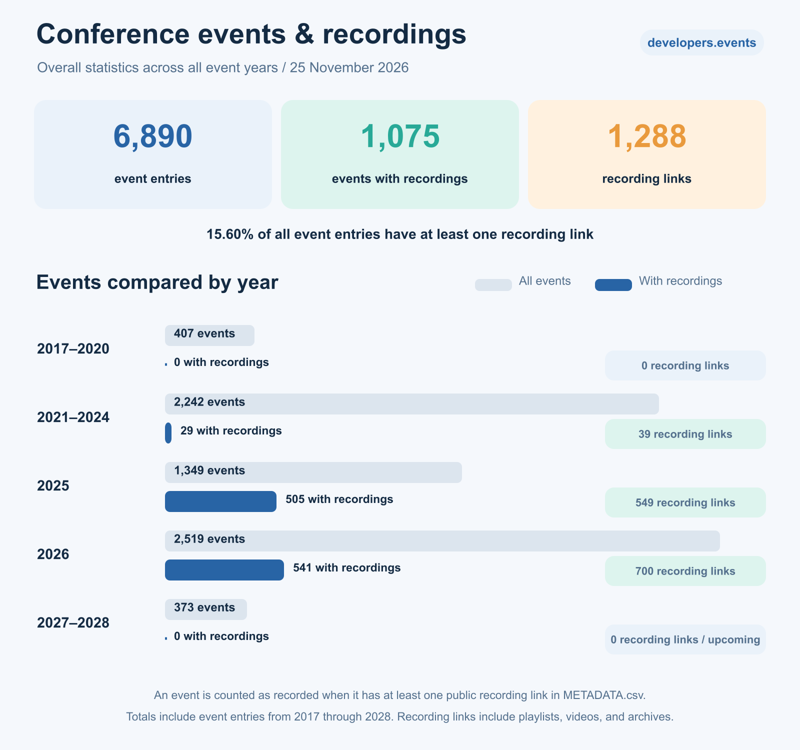

# Recording statistics

Last updated: 25 November 2026

This page summarizes recording coverage in the current repository data.
`METADATA.csv` is the source of record; `tools/mdParser.js` derives the event
data used by the website. Regenerate this page with
`node tools/generateRecordingsStats.js` after metadata changes.

An event counts as recorded when it has at least one public recording link.
Recording links include playlists, individual videos, archives, and organizer
pages. Links are counted per event entry, not as the number of videos contained
inside a playlist.

## Overall

| Metric | Value |
|---|---:|
| Event entries | 6,890 |
| Events with at least one recording | 1,075 (15.60%) |
| Recording links | 1,288 |
| Events with multiple recordings | 84 |
| Playlist links | 1,047 (81.29%) |
| Video or other links | 241 (18.71%) |
| YouTube links | 1,242 (96.43%) |

## By event year

Events are grouped by the year of their start date.

| Event year | Event entries | With recordings | Coverage | Recording links | Multiple recordings | Playlists | Videos / other |
|---|---:|---:|---:|---:|---:|---:|---:|
| 2017–2020 | 407 | 0 | 0.00% | 0 | 0 | 0 | 0 |
| 2021–2024 | 2,242 | 29 | 1.29% | 39 | 2 | 39 | 0 |
| 2025 | 1,349 | 505 | 37.44% | 549 | 16 | 491 | 58 |
| 2026 | 2,519 | 541 | 21.48% | 700 | 66 | 517 | 183 |
| 2027–2028 | 373 | 0 | 0.00% | 0 | 0 | 0 | 0 |
| **Total** | **6,890** | **1,075** | **15.60%** | **1,288** | **84** | **1,047** | **241** |

Future years are included in the event-entry totals but naturally have no
recordings yet. Coverage therefore describes the current metadata snapshot, not
a permanent property of an event year.

## Events with the most recording links

This table lists every event with five or more recording links. Ties are ordered
by date and event name.

| Event | Date | Recording links |
|---|---|---:|
| IndiaFOSS 2026 | 2026-09-26 | 16 |
| IndiaFOSS 2025 | 2025-09-19 | 11 |
| Commit Your Code Conference | 2026-09-03 | 10 |
| AI Engineer World's Fair 2024 | 2024-06-25 | 9 |
| FOSSASIA Summit 2026 | 2026-03-09 | 8 |
| Craft Conference 2026 | 2026-06-02 | 8 |
| BDX I/O 2026 | 2026-10-29 | 8 |
| Open Community Experience (OCX) | 2026-04-21 | 7 |
| PyCon UK 2025 | 2025-09-19 | 6 |
| Devoxx France 2026 | 2026-04-22 | 6 |
| PlatformCON Virtual | 2026-06-22 | 6 |
| EuroBSDCon | 2026-09-09 | 6 |
| All Things Open | 2026-10-18 | 5 |

## Link classification

Playlist links are identified by a `list=` URL parameter. Everything else,
including individual videos, channel pages, and archive pages, is classified as
video/other. This is a URL-based classification and does not count the
individual videos contained within a playlist.

Recording numbers are a snapshot of the public links currently recorded in
`METADATA.csv`. Missing links mean no public recording has been recorded in the
metadata, not that no recording exists. Re-run the metadata parser and this
script after data changes to keep this page and its infographic synchronized
with the generated event data.
